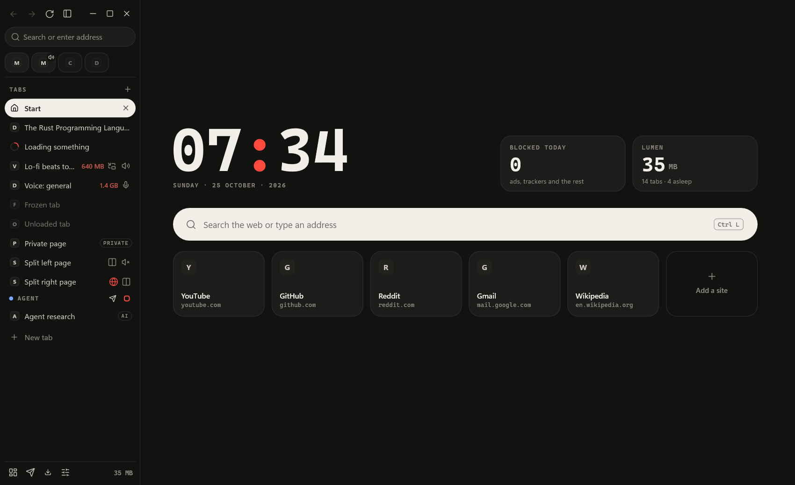
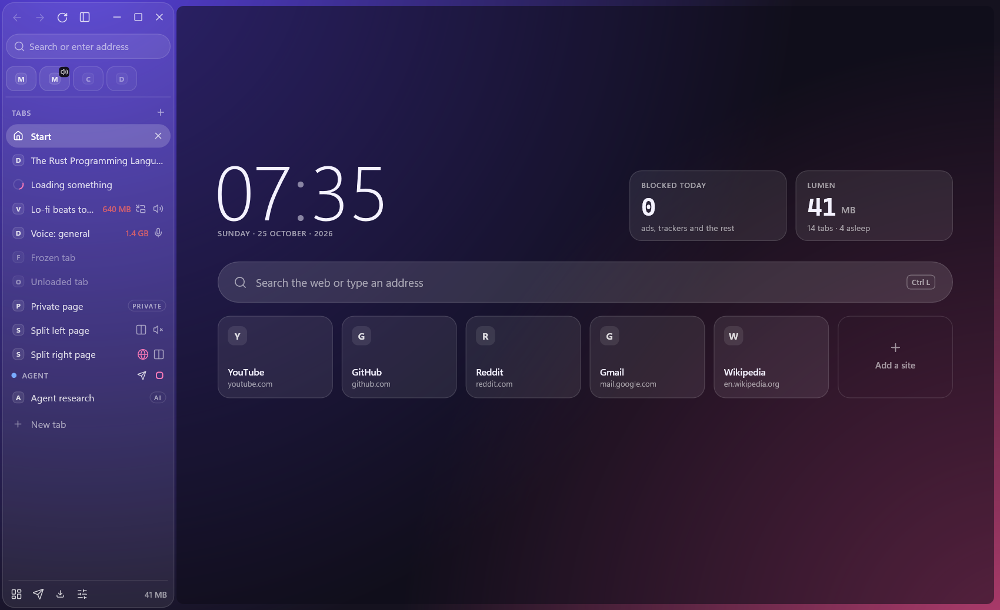
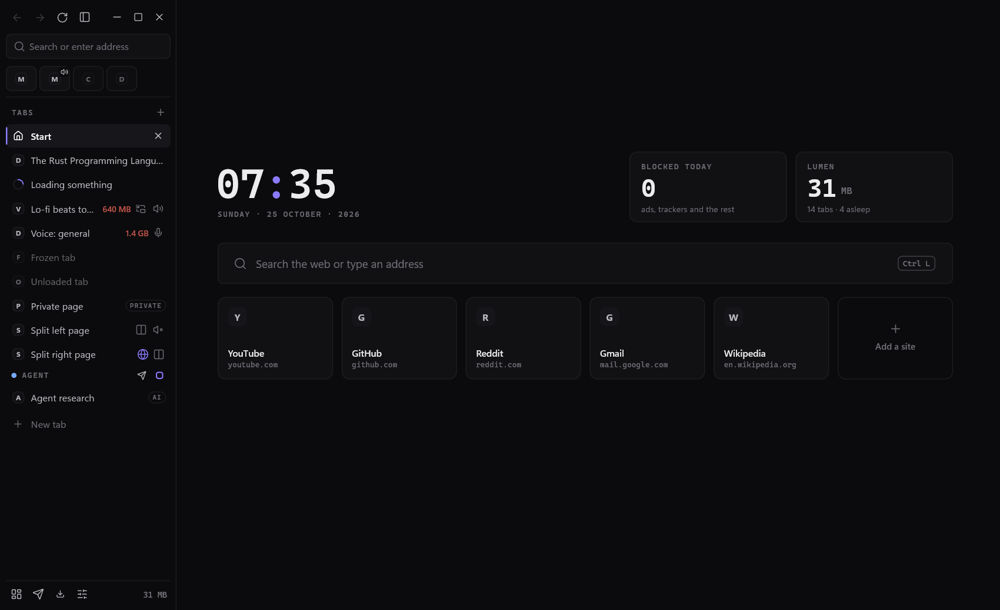

# lumen

a small shell around webview2 for windows. it exists to use as little RAM as it can and to keep browsing simple.

rust, with every bit of interface (sidebar, tabs, menus, settings, file pickers) drawn by hand with direct2d. the pages themselves are rendered by microsoft's webview2, the same engine edge uses.

<p align="center">
  
</p>

> [!WARNING]
> **lumen is not a full browser, and it isn't trying to compete with brave, edge, chrome or firefox.** those are built by large teams, with security reviews, extensions, sync and years of work behind them. lumen is one person's project. if you need any of that, use them.

> [!CAUTION]
> the ui is unfinished. some screens are rough, some settings are missing, and things will move around or break between versions. it's my daily driver, but expect sharp edges.

## why it exists

i used a youtube music desktop client built the same way, rust around webview2, and it glitched constantly. fixing that itch turned into this.

so it's for two things: low memory, and a quiet place to read the web. hidden tabs freeze and then unload, the interface is one process, and nothing runs that you didn't ask for.

brave was my daily driver before this, so that's what i measured against. same laptop, fresh profiles, whole process tree:

| | lumen | brave |
|---|---|---|
| nothing open | 36 MB | 151 MB |
| one wikipedia tab | 49 MB | 192 MB |
| 20 tabs, 6 min later | 124 MB | 1111 MB |

one machine, measured with `tools/vs_brave.py` on 0.6.7.2. brave does a lot more than lumen does, so this is what each costs on my laptop, not which is better.

## what's in it

- ads and trackers blocked (adblock-rust, easylist, easyprivacy, ublock lists), cookie banners hidden, pop-ups and sneaky redirects stopped
- a privacy report that only shows things it actually counted
- tabs that sleep, show what they cost on hover, and leave sooner when they get heavy
- downloads through aria2: many connections, resume, torrents
- lock a tab, or all of lumen, with windows hello. a secret downloads folder too
- offline translation, reader view, read aloud, split view, workspaces, pinned tabs
- three looks: signal, glass, precise

<p align="center">
  
  
</p>

## what it isn't

- **not a security product.** pages run inside webview2, which windows keeps updated, but lumen's own code has never been audited. for banking and anything you can't afford to lose, use a mainstream browser.
- **no extensions, no sync, no accounts.** there's a reader for a keepass file, but no password manager.
- **the locks are a convenience.** a locked tab or the secret downloads keep things out of sight of someone using lumen. the secret folder is hidden, not encrypted; anyone signed in to windows as you can still find it.
- **the ai agent side is experimental.** letting a model drive a browser has real risks: a page can try to talk the model into things. lumen hands logins, payments and messages back to you, but don't point agents at anything sensitive.
- **windows 10 and 11, 64-bit only.** no mac, no linux.
- **not signed**, so smartscreen will complain the first time.
- **built with a lot of ai help.** i wrote it with claude doing much of the typing. it's tested, but bugs will be there, and settings may not survive every update.

## your data

lumen keeps a usage journal on your pc: how fast pages loaded, memory, cpu, crashes and errors. sites are kept by name only, never a full address, a page title or anything you typed. private tabs leave nothing in it. it lives in `%APPDATA%\Lumen\journal` and **never leaves your pc on its own**: lumen has no telemetry and phones nothing home.

- **turn it off:** settings > privacy > keep a usage journal.
- **help make lumen better:** settings > about > share your numbers. it builds a report from the journal with every address and site name scrubbed out, shows you all of it, and sends only when you press send (through a small form service to my inbox). you can copy or save it instead and send it however you like.
- **found a bug:** settings > about > report a problem works the same way, or open an issue with the output of `lumen.exe --doctor`.

## agents

lumen speaks MCP. `lumen-agent.exe` is the bridge; each agent gets its own tabs and its own profile.

```
claude mcp add -s user lumen -- %LOCALAPPDATA%\Programs\Lumen\lumen-agent.exe mcp
```

more in [docs/agents.md](docs/agents.md).

## install

grab the installer from [releases](../../releases). webview2 is already on every windows 11 machine; the installer fetches it on windows 10 if it's missing.

if something's off, `lumen.exe --doctor` checks the install and tells you what to fix.

## build

```
cargo build --release
```

rust 1.98+, windows only. `cargo test` runs the unit tests; the live suites in `tests/` drive a headless lumen.

## license

GPL-3.0. third-party pieces (ublock scriptlets, dark reader, readability, dompurify, bergamot, lucide) keep their own licenses, next to them in `assets/`.
