# Lumen

A native Windows shell around WebView2, written in Rust, built to keep memory low. Version 0.6.5,
18 October 2026. Early, in daily use by one person, Windows only.

## What it is

Lumen is a Windows program that shows web pages. It does not draw them. Pages are drawn by
Microsoft WebView2, the Chromium-based engine already installed on every Windows 11 machine.
Everything around the page is Lumen's own code: the window, the tabs, the sidebar, the content
blocker, the downloads and the memory policy. That part is about 45,000 lines of Rust.

A page in Lumen costs about what the same page costs in any Chromium-based program, because it is
the same engine. What Lumen controls is the rest: how heavy the shell is, how many renderer
processes run, and what happens to pages you are not looking at. That is where the numbers below
come from.

It is also a place for AI agents to work. Agents drive it over MCP, each in tabs and a profile of
its own.

## How it looks

Lumen draws its own window, so it can look like anything. Until 0.6.0 it looked like a settings
dialog. Now it has three looks, and each is a whole set: colours, type, corners and motion. Pick
one at first run, change it in Settings > Appearance.

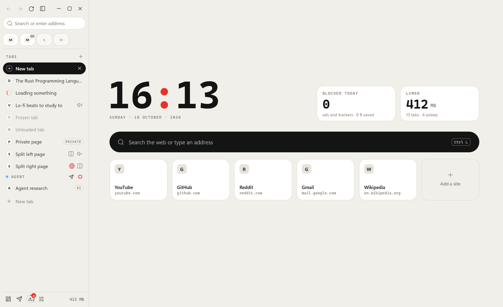

**Signal** is the default. Warm paper and black ink, labels in spaced monospace capitals, one red
signal. Light and dark.

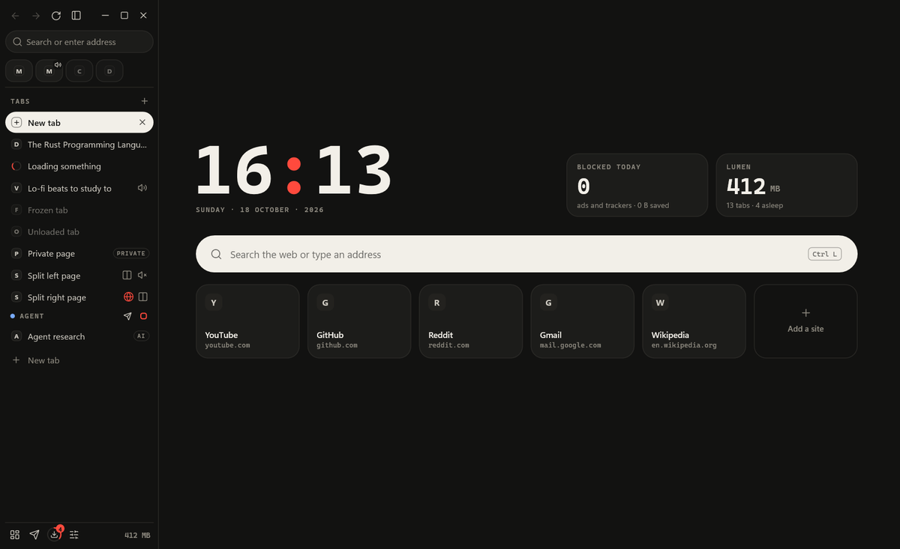

**Glass** is a frosted sidebar over a colour wallpaper, the page a floating card, light type, no
monospace. **Precise** is near-black, hairlines, square-ish corners, one violet accent.

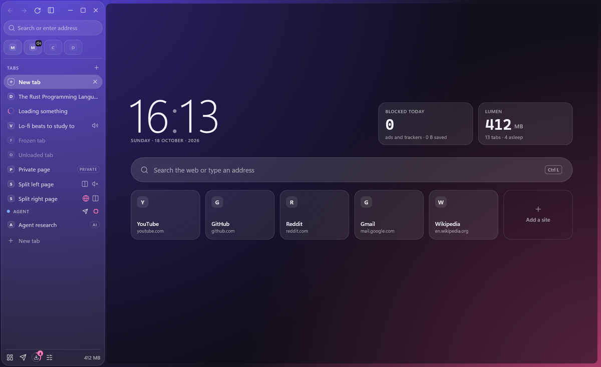

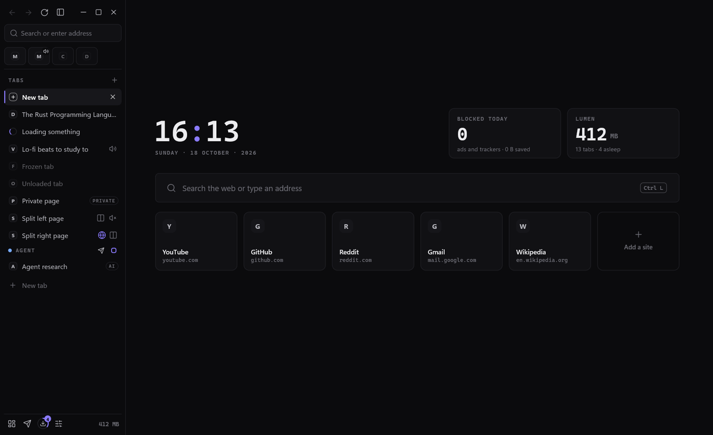

The rules all three keep:

- **One accent, one meaning.** The accent colour marks something live: a working agent, a
  running Drive, a download, the clock's colon. Nothing else gets it. Buttons, chosen options and
  the current tab are ink.
- **Cards.** Every page is cards on the ground: Settings, History, Downloads, Bookmarks, Site
  settings, Control, the Dashboard, the Privacy report, Drive. Every card that floats (tab search,
  the site card under the lock, address suggestions, an agent asking for you, a site asking for
  the camera, a message to an agent) is the same card.
- **Site icons**, kept on disk by site. A start-page tile without one asks that site for its own
  icon, once a run. No icon service ever sees the address.
- **Every layout.** Vertical (the sidebar), horizontal (a tab strip, like Chrome) and hybrid (the
  sidebar under a toolbar), compact or not, sidebar left or right. The page is a window of its
  own on top of Lumen's drawing, so a card that has to reach over it lifts Lumen's window above
  the page, cut down to its own strips and the card, and drops it back when the card closes.

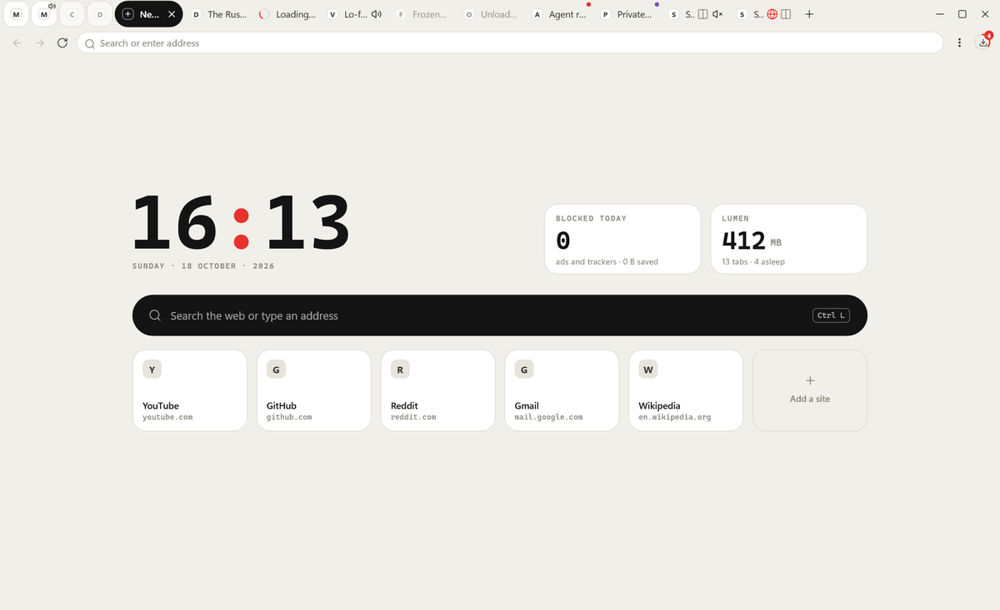

The design was drawn first, as a page of mockups, and approved before a line of it was built:
[docs/design/lumen-ui.html](design/lumen-ui.html).

## Spec

| Part | Detail |
|---|---|
| Language | Rust 1.98, edition 2024 |
| Runs on | Windows 10 and 11, x64 |
| Page engine | Microsoft WebView2 (Chromium), through wry 0.57 and webview2-com 0.39 |
| Window and interface | tao 0.37; every pixel drawn natively with Direct2D and DirectWrite, no HTML |
| Code | about 45,300 lines of Rust, one process for the shell |
| Binaries | `lumen.exe` 16.5 MB, `lumen-agent.exe` 2.1 MB (release, stripped) |
| Tests | 374 unit tests, plus live suites that drive a real headless Lumen |
| Content blocker | adblock-rust 0.13, EasyList, EasyPrivacy, uBlock lists; about 1.7 µs a request |
| Agent interface | MCP: an HTTP endpoint on localhost behind a token, and a stdio bridge; 47 tools |
| Scripts | Luau (sandboxed, through mlua), for scripts the person writes and agents run |
| Data | `%APPDATA%\Lumen`: settings, session, filters, history, the WebView2 profile |

What it is built from, all pinned, anything that runs checked by SHA-256 before it runs:

| Project | What it does in Lumen | License |
|---|---|---|
| adblock-rust (Brave) | Blocks ads and trackers; hides leftovers with CSS | MPL-2.0 |
| uBlock Origin 1.75.0 scriptlets | Strips ads out of YouTube's player data before the page reads it | GPL-3.0 |
| EasyList, EasyPrivacy, uBlock lists | The rules: ads, trackers, cookie banners, tracking parameters | CC BY-SA / GPL |
| URLhaus and phishing filter lists | Malware and phishing hosts, refreshed weekly | MIT |
| Dark Reader 4.9.133 | Dark pages for sites without a dark mode | MIT |
| Mozilla Readability 0.6.0, DOMPurify | Reader view, and article text for agents | Apache-2.0 / MPL-2.0 |
| Bergamot | Page translation on the PC | MPL-2.0 |
| aria2 1.37.0 | Downloads with up to 16 connections, torrents | GPL-2.0 |
| yt-dlp, FFmpeg | Saving the video on a page | Unlicense / GPL |
| wry, tao, windows-rs | The window, the WebView2 binding, every Win32 call | MIT / Apache-2.0 |

## Performance

All numbers are measurements on one laptop: release builds, a throwaway profile, and Task
Manager's "Memory" figure (private working set) unless a chart says otherwise. They compare
Lumen with earlier versions of itself. A side-by-side run against other programs on the same
pages has not been done yet, so there is no such claim here.

### The shell

<picture>
  <source media="(prefers-color-scheme: dark)" srcset="img/history-dark.svg">
  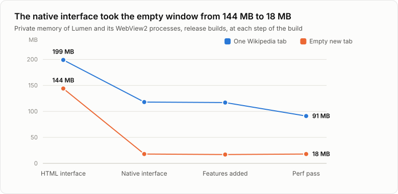
</picture>

Replacing an interface written in HTML with one drawn natively took an empty window from 144 MB
in five processes to 18 MB in one. A later pass on the event loop and on sleeping tabs took one
Wikipedia tab from 117 MB to 91 MB, and its CPU from 0.47% to 0.16%.

| Step | Empty new tab | One Wikipedia tab |
|---|---|---|
| HTML interface | 144 MB | 199 MB |
| Native interface | 18 MB | 118 MB |
| Features added | 17 MB | 117 MB |
| Perf pass | 18 MB | 91 MB |

### Idle

<picture>
  <source media="(prefers-color-scheme: dark)" srcset="img/idle-dark.svg">
  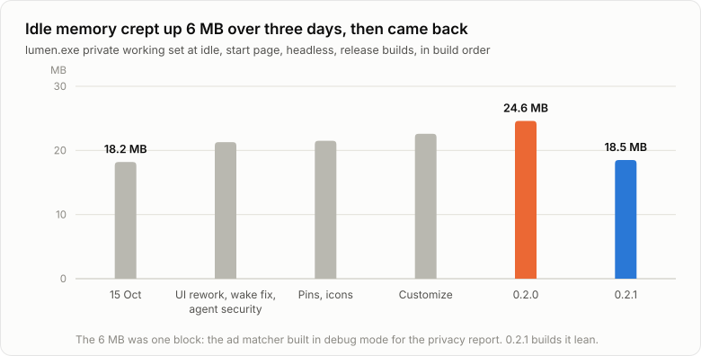
</picture>

Idle memory crept up over three days of features. A count of the heap found almost all of the
growth in one allocation: the content blocker's compiled rules, built in a debug mode that keeps
every rule's text, only to tell an ad from a tracker in a report. 0.2.1 builds the rules lean and
answers that question with a 380 KB table of tracker host hashes. The malware and phishing lists
added in the same release hold 81,000 hosts the same way, for 0.5 MB. The redraw in 0.6 added
three looks, cards, icons and floating cards, and idle went down, not up: 18.7 MB.

| Build | Idle |
|---|---|
| 15 October | 18.2 MB |
| UI rework, wake fix, agent security | 21.3 MB |
| Pins, icons | 21.5 MB |
| Customize | 22.6 MB |
| 0.2.0 | 24.6 MB |
| 0.2.1 | 18.5 MB |
| 0.4.0 | 19.2 MB |
| 0.6.2, the redraw | 18.7 MB |

### Many tabs

<picture>
  <source media="(prefers-color-scheme: dark)" srcset="img/tabs40-dark.svg">
  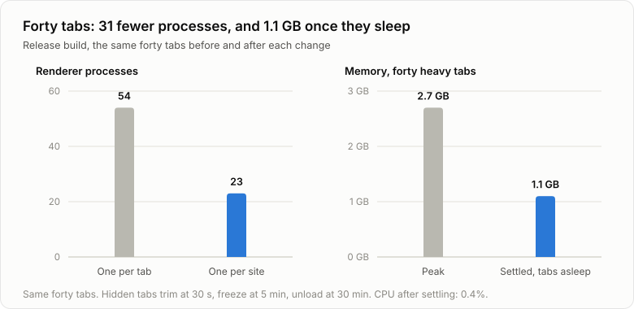
</picture>

Two policies do this. One renderer per site instead of one per tab: forty tabs went from 54
renderer processes to 23, about 310 MB less. And tabs you are not looking at sleep: their caches
are trimmed after 30 seconds, they freeze after 5 minutes and unload after 30. Forty heavy tabs
peaked at 2.7 GB and settled at 1.1 GB, at 0.4% CPU.

### Video, and one trade-off

<picture>
  <source media="(prefers-color-scheme: dark)" srcset="img/gpu-dark.svg">
  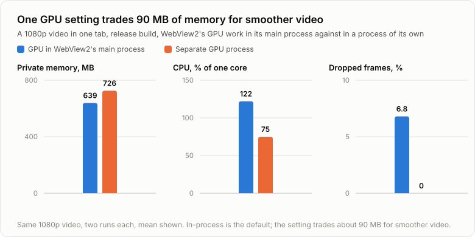
</picture>

By default WebView2's GPU work runs inside WebView2's main process: one process and about 90 MB
fewer. The cost shows in video: a 1080p video dropped 6 to 8% of its frames and used more CPU.
A setting moves the GPU work back to its own process when smooth video matters more than memory.

| | GPU in WebView2's main process | Separate GPU process |
|---|---|---|
| Private memory | 639 MB | 720 to 733 MB |
| CPU, one core | 118 to 127% | 70 to 80% |
| Dropped frames | 5.8 to 7.8% | 0% |
| Processes | 8 | 10 |

### Waking up

<picture>
  <source media="(prefers-color-scheme: dark)" srcset="img/wakes-dark.svg">
  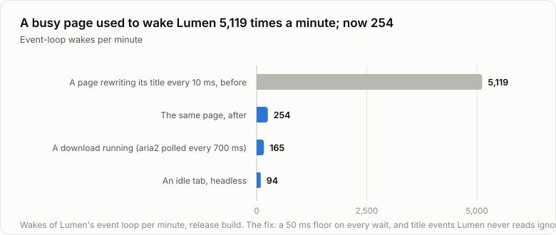
</picture>

A page that rewrote its title every 10 ms woke Lumen's event loop 8,531 times in 100 seconds. Now
the loop never waits for less than 50 ms, and it ignores events it never reads.

### Other measured numbers

| What | Number |
|---|---|
| One agent tab | about 85 MB |
| Agent tool call, a round trip to the window | 0.7 ms (35 ms before 0.4.0) |
| Agent: fill and send a form, ten-step workflow | 1.7 s and 2.6 s (5.7 s and 8.8 s before 0.4.0) |
| Agent: the ten-step workflow as a Luau script | 1 call and 580 bytes back, against 12 calls and 4 KB |
| Content blocker, per request | about 1.7 µs |
| Usage journal, on against off | under 0.1% CPU, under 1 MB |
| CPU cap set to 50% | 52% measured |
| Network cap set to 2048 KB/s | about 1,990 KB/s measured |
| A 100 MB download, before and after tuning aria2 | 17.8 s to 15.5 s mean (runs of the same build swung by 46%) |
| Servo, an experimental engine behind a build flag | renders Hacker News in 38 MB |

## What it does

- Three looks (Signal, Glass, Precise), in vertical, horizontal or hybrid layouts. Colours,
  fonts, shapes, motion, clock and wallpaper can all be changed, and Settings has a search box.
- Content blocking for ads, trackers and cookie banners, on by default. The lock in the top bar
  opens the site card, with one switch that turns blocking off for that site alone; Settings >
  Site permissions lists every such site with a Reset on its row.
- Pop-ups blocked unless you clicked for them. Malware and phishing sites get a warning page.
- A privacy report: what was blocked and what was counted, with trends.
- Reader view, dark pages, translation on the PC, read aloud.
- Downloads through aria2, torrents, saving the video on a page.
- History you can search by what a page said.
- Pins, bookmarks with folders and import, a speed dial, workspaces, split view, tab search.
- KeePass logins filled from a `.kdbx` file, kept in memory only, locked after 10 minutes.
- Can be set as Windows' default for web links.
- A usage journal on the PC (memory, CPU, slow sites, crashes) that sends nothing anywhere.
- Settings > About: what's new (the changelog, built in, a card per version), a problem report
  you read in full and send with one press, and who made Lumen. After a crash, the start page
  offers that report once.

## For AI agents

Any agent on the machine can drive Lumen through MCP: Claude Code, opencode, Codex, Cursor. One
program, `lumen-agent`, connects them. It finds Lumen and its token by itself, so an agent's
config holds a path, never a secret.

- An agent sees a page as a snapshot: every heading and control, each with a short ref like `e5`.
  It clicks and types by ref, with real input events.
- Every agent gets its own tabs and its own profile, with its own cookies and storage. One agent
  cannot see another's tabs, and none can see yours unless you lend one.
- When a login, a captcha or a payment needs a person, the agent hands the tab over and waits.
- `lumen.exe --headless` runs Lumen off-screen: no focus, no taskbar button, no sound.
- Drive: type a task, press Run, and Lumen starts an agent CLI on it. The page shows the steps in
  plain words ("going to amazon.com", "typing ...") with how long each took, and what the agent
  says beside them.

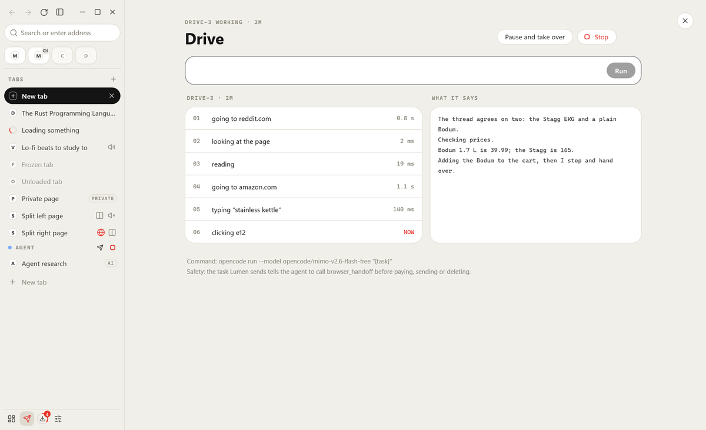

- Agent tabs live on a stage: a window of their own, off every screen, where Chromium still counts
  them as visible. Clicks land, and nothing comes to the front. Click an agent's tab to watch it
  live; the agent keeps working.
- Replies say what happened: a failed page's HTTP status, what a click changed or that it changed
  nothing. Page text is fenced, so a page cannot pose as the person.
- Fewer calls: `browser_batch` (up to 20 calls in one), `browser_fill` (a whole form),
  `browser_table`, `browser_links`. And Luau scripts: the person puts `.luau` files in a folder,
  agents list and run them. Every call a script makes is checked as if the agent made it.

The first real test, on 18 October, found reading fast and clicking broken: in a background tab a
click did nothing and still answered "clicked". 0.3.0 fixed that with the stage, 0.4.0 made every
call faster.

The design for that work is in [the agent-side spec](superpowers/specs/2026-10-18-agent-side-design.md).

## The plan

In order. Each step ships as its own version, with a line in [the changelog](changelog.md).

1. **Honest replies and a smoke test.** A failed page says its HTTP status. A click says what it
   changed, or that nothing changed. Page text is marked as page text, so a page cannot pose as
   the person. Before every release, a live test clicks real buttons. *Done in 0.3.0.*
2. **The agent stage.** Agent tabs live in a window of their own, off every screen. WebView2 sees
   them as visible, so clicks land, and nothing comes to the front. *Done in 0.3.0.*
3. **Watching.** Click an agent's tab to see its live page, with the agent's own cursor in the
   accent colour. Your mouse cannot knock it off. *Done in 0.5.0.*
4. **Talking to an agent.** A text field to steer an agent now, queue its next task, or start a
   new one. *Done in 0.5.0.*
5. **Speed for agents.** Fewer calls and smaller replies: batches of steps, Luau scripts, and
   higher-level tools for forms and tables. *Done in 0.4.0.* Snapshots that send only what
   changed are still to do.
6. **Headless trims.** Measure first, then cut what an off-screen Lumen still does for nobody.
7. **The comparison.** Lumen against other Chromium-based programs on the same pages and the same
   machine, published with the method.
8. **Source.** The code is meant to be published. Its license follows from what it bundles:
   uBlock's scriptlets are GPL-3.0.
9. **An installer.** Signed, so Windows does not warn about an unknown publisher, with updates
   that arrive by themselves.

Next to think through with the person, before anything is built: a scraping tool baked into
Lumen, with room for the scraping tools people already use, and agents at scale, many of them
browsing at once.

Later, and only if they earn their memory: Servo for light sites, a local AI model reading the
page through Ollama, and an optional PDF editor that starts only when asked.

## Limits

- Windows only. WebView2 is the engine.
- No Chrome or Edge extensions. Ad blocking, dark pages, passwords through KeePass and translation are
  built in. Anything else is not there.
- Early. Built in five days by one person and Claude, with AI workers writing much of the code and
  every change reviewed before it landed. Expect rough edges.

The rule does not change: if a feature costs memory while you are not using it, it had better be
worth it.
